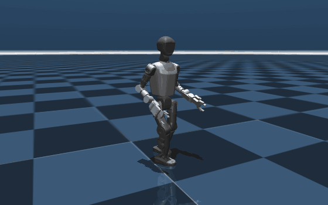
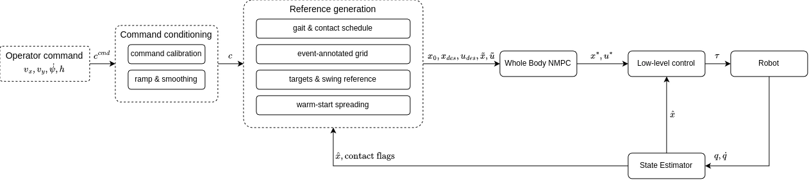

*The T1 in MuJoCo walking at 0.25 m/s while turning at 0.15 rad/s.*

A whole-body nonlinear model predictive controller (NMPC) for walking on the Booster T1. One optimal control problem plans the whole robot (base motion, all 27 joints and both feet's contact wrenches) 1.1 s ahead and is re-solved every 20 ms. A 500 Hz layer tracks the plan with joint PD plus torque feedforward.

There is no footstep planner: no foothold variables, no swing-foot targets in the plane and no capture-point rule. Where each foot lands emerges from the optimization.

How it works
======

The operator command is calibrated and smoothed. Every 20 ms, reference generation builds the gait and contact schedule, lays an event-annotated time grid on it, and produces the reference trajectories and the solver's warm start. The NMPC solves for the plan, and the 500 Hz low-level controller turns it into joint torques. The state estimator closes the loop, and a sensed touchdown re-times the schedule at the next solve.

* **One kinodynamic OCP.** 66 states and 39 inputs (two 6-D contact wrenches and 27 joint accelerations). Only the six unactuated base rows of the dynamics are enforced; the joint torques are recovered from the plan by inverse dynamics.
* **Real-time by construction.** One SQP iteration per solve, the contact constraints eliminated per stage by null-space projection, and the QP solved by HPIPM's Riccati recursion: about 8–9 ms median per solve on a Ryzen 9 7950X.
* **Emergent stepping.** Step length and width, foot rotation about the heel and toe edges, and the center of pressure are the optimizer's decisions, shaped by a LIP/DCM reference for the center of mass. Step timing follows a speed-keyed gait schedule.
* **Hardware-style sensing.** The state estimator reads only joint encoders, the IMU and planar odometry, and detects contact both kinematically and from joint-torque residuals.

Results in simulation
======
* Walks the T1 in MuJoCo across a certified command envelope: forward up to 0.45 m/s (turning up to 0.3 rad/s at that speed), backward at 0.30 m/s, sideways at 0.25 m/s, turning in place, and two-minute turning walks.
* The 0.45 m/s walk still holds with 20 busy CPU processes competing with the solver.
* Certified over 54 simulated runs across 33 scenario cells.

**Code:** [github.com/helpYoon/t1_wbc](https://github.com/helpYoon/t1_wbc)

**Tools:** C++, Python, Pinocchio, CasADi, HPIPM, BLASFEO, MuJoCo
