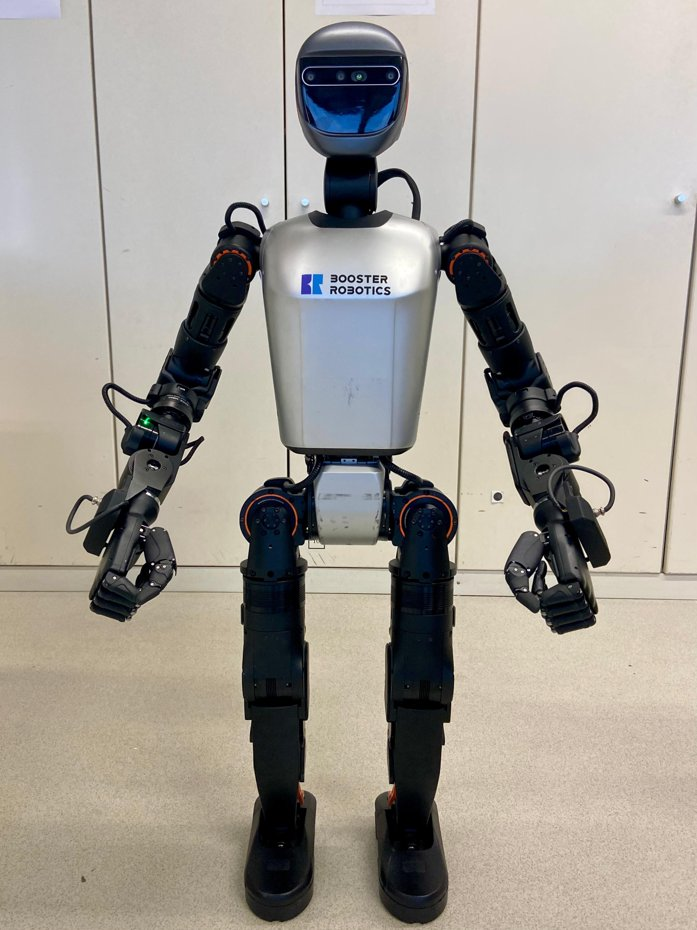
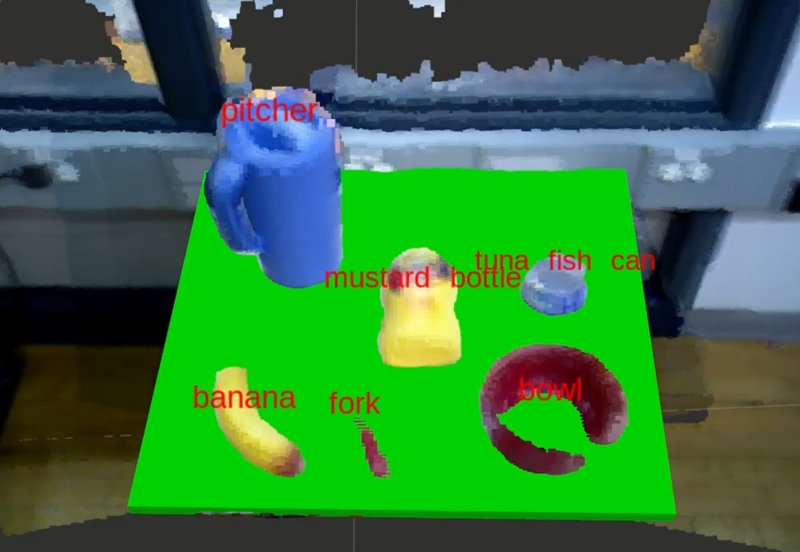
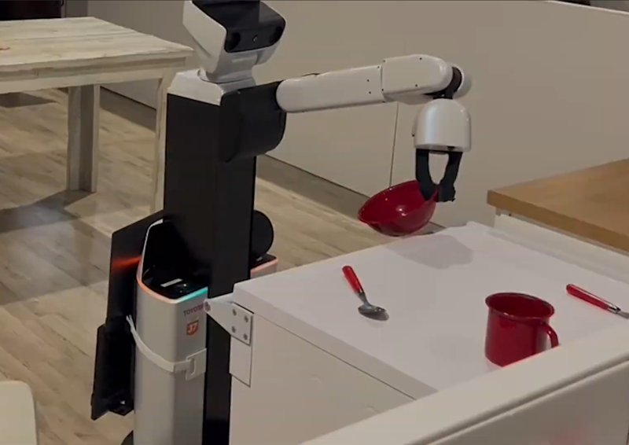
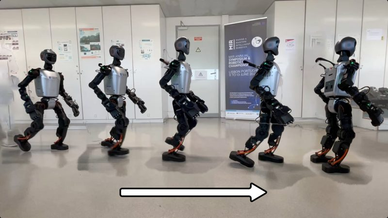
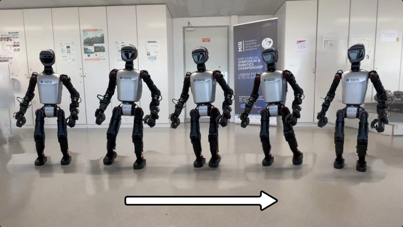
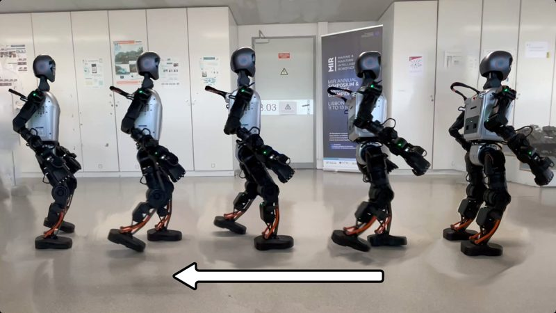
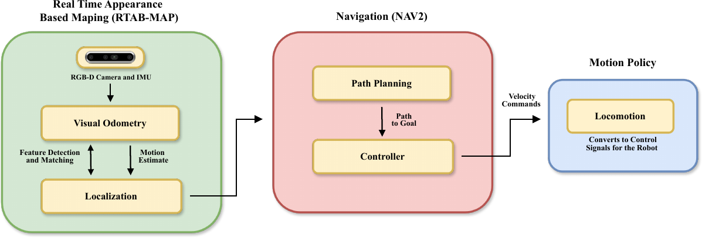

*The team's Booster T1, with EG2-4C2 electric grippers in place of its hands.*

RoboCup@Home tests service robots on household tasks such as storing groceries, receiving guests, carrying items for a person and carrying out spoken commands. I am part of LisTex United, a new team formed by UT Austin and the Institute for Systems and Robotics at IST, University of Lisbon, through the joint [FOMO-HODOR](https://irsgroup.isr.tecnico.ulisboa.pt/fomo-hodor/) project. The team's goal is a single system that completes every task, rather than a separate program for each one.

* The robot is a **Booster T1 humanoid**, with its hands replaced by EG2-4C2 electric grippers.
* The team builds on UT Austin Villa@Home, which placed **2nd** in the RoboCup@Home Domestic Standard Platform League (DSPL) in 2025, with one of the highest scores in the Enhanced General Purpose Service Robot (EGPSR) test.

The system
======
* **Architecture.** Three layers share a central knowledge base: reactive control (hierarchical state machines), deliberative control (a planner and plan executor), and skills such as pick-up, navigate and follow.
* **Knowledge representation.** Grounded knowledge lives in a SQL database that perception keeps up to date. The robot can reason about objects a user asks for but that it has not seen yet.
* **Command understanding.** Speech is transcribed locally with Whisper and Vosk, and GPT-4o parses it into a JSON command that follows the task's grammar, correcting transcription errors along the way. It parsed every command the team received in the 2024 and 2025 competitions.
* **Semantic perception.** Fine-tuned YOLO segmentation and Grounded-SAM detect objects, which are fused into instance-level 3D point clouds and a queryable scene graph.
* **Manipulation.** GraspGen samples 6-DoF grasps from object point clouds, with bounding-box grasps for flat, box-shaped and deformable objects. MoveIt plans run in parallel with execution, and a closed-loop step aligns the gripper using detections from the hand camera before grasping.
* **Person tracking and following.** BoT-SORT tracks people in the map frame, YOLO-pose recognizes gestures (waving, raising arms, pointing), and re-identification recovers people who leave the view. Following samples goal poses near the person with RRT\* under Behaviour Trees.
* **Mapping and navigation.** A legged robot has no wheel odometry, so RTAB-Map estimates visual odometry from the RGB-D camera and IMU, builds the map, and relocalizes through visual loop closures. Nav2 plans paths on that map and sends velocity commands to the motion policy. With no LiDAR on the robot, the camera's point cloud updates the costmaps, and the controller only moves forward or turns in place, so the robot always moves where the camera can see obstacles.
* **Motion policy.** Our own locomotion policy, trained with FastTD3, turns the velocity commands into walking on the real T1: forward, backward, sideways and turning. It is noticeably more robust and fluid than the T1's stock walking controller.

<figure style="flex:1 1 260px; margin:0"><figcaption>Object and plane detections after scanning a table.</figcaption></figure>
<figure style="flex:1 1 260px; margin:0"><figcaption>A successful grasp of a bowl.</figcaption></figure>

<figure style="flex:1 1 180px; margin:0"><figcaption>Forward.</figcaption></figure>
<figure style="flex:1 1 180px; margin:0"><figcaption>Sideways.</figcaption></figure>
<figure style="flex:1 1 180px; margin:0"><figcaption>Backward.</figcaption></figure>

*The locomotion policy on the real Booster T1.*

*The autonomous navigation stack: RTAB-Map, Nav2 and the motion policy.*

More detail on the shared system is in UT Austin Villa@Home's [2026 Team Description Paper](https://www.cs.utexas.edu/~AustinVilla/athome/PDFs/UT_Austin_Villa_Home_2026_Team_Description_Paper.pdf).

**Tools:** ROS 2, MoveIt, YOLO, Grounded-SAM, GraspGen, Whisper, GPT-4o, RTAB-Map, Nav2, FastTD3
